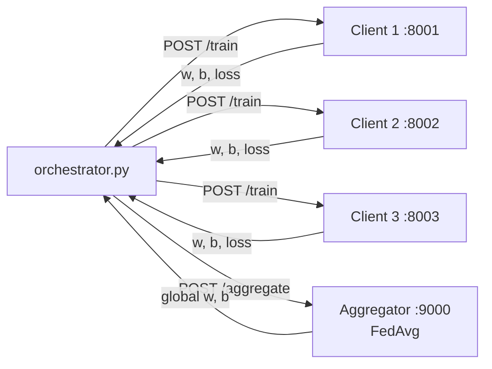

# Federated Learning Lab

A small federated learning system: FastAPI client services train a linear model locally (Numba CUDA kernel, CPU fallback) and a central aggregator combines their parameters with Federated Averaging. Packaged with Docker and scripts for running clients on separate machines against a remote aggregator.

## What it does

- Each client generates its own private synthetic dataset (`y = 3.5x + 2.0 + noise`, 1,000 points, seeded per client) and trains `y = w·x + b` with gradient descent.
- Gradients are computed on the GPU by a Numba `@cuda.jit` kernel (one thread per sample, `cuda.atomic.add` accumulation); if CUDA is unavailable the client falls back to vectorised NumPy.
- Clients share only `(w, b, loss)`, never data. The aggregator averages the parameters (FedAvg, unweighted mean) and reports the global model.
- Two coordination modes:
  - **Orchestrated**: `orchestrator.py` health-checks every service, triggers `/train` on all clients in parallel, posts the updates to `/aggregate`, and writes `fl_results.json`.
  - **Distributed**: clients started with `MODE=DISTRIBUTED` register with the aggregator (`/join`), poll `/status`, train when a round opens, and `/submit` their update. The aggregator aggregates once 2 clients have submitted; `/reset` opens the next round.

## Tech stack

Python · FastAPI / Uvicorn · Pydantic · httpx (async) · NumPy · Numba CUDA · Docker / Docker Compose (NVIDIA CUDA 12.2 base image) · Bash

## How it works



In distributed mode the orchestrator is not used: each client talks to the aggregator directly over HTTP (`/join`, `/status`, `/submit`).

| Service | Endpoints |
|---|---|
| Client (`client.py`) | `GET /health`, `POST /train`, `GET /` |
| Aggregator (`aggregator.py`) | `GET /health`, `GET /status`, `POST /join/{id}`, `POST /submit`, `POST /reset`, `POST /aggregate` |

Interactive API docs are served at `/docs` on each service (FastAPI).

## Results

The committed `fl_results.json` and `logs_*.txt` record one orchestrated round with 3 clients, run locally **on CPU** (the logs show `CUDA available: False`):

| | w | b | MSE loss |
|---|---|---|---|
| Client 1 | 2.176 | 1.298 | 2.220 |
| Client 2 | 2.348 | 1.249 | 2.025 |
| Client 3 | 2.265 | 1.285 | 2.106 |
| **Global (FedAvg)** | **2.263** | **1.277** | 2.117 (avg) |
| Target | 3.5 | 2.0 | |

The pipeline runs end to end, but the model is under-trained: 100 epochs at learning rate 0.01 is not enough for gradient descent from `w = b = 0` to reach the target. Increasing `EPOCHS` or `LEARNING_RATE` in `client.py` closes the gap.

## Getting started

Requires Python 3.8+. A CUDA-capable NVIDIA GPU is optional (CPU fallback).

```bash
python3 -m venv venv && source venv/bin/activate
pip install -r requirements.txt

# One command: starts 3 clients + aggregator, runs one round, writes fl_results.json
./test_local.sh
```

Or start the services by hand:

```bash
CLIENT_ID=1 PORT=8001 python3 client.py
CLIENT_ID=2 PORT=8002 python3 client.py
CLIENT_ID=3 PORT=8003 python3 client.py
python3 aggregator.py          # port 9000
python3 orchestrator.py        # runs the round
```

**Distributed mode** (aggregator on a server, clients on other machines):

```bash
# On the server
docker compose up -d --build     # aggregator only; host port 8000 -> container 9000

# On each client machine (Docker; uses the GPU if nvidia-smi is present)
./run_distributed_client.sh <client_id> http://<aggregator-host>:<port>
```

See [DISTRIBUTED_GUIDE.md](DISTRIBUTED_GUIDE.md) for the distributed setup and [VPS_GUIDE.md](VPS_GUIDE.md) for provisioning a GPU server (drivers, NVIDIA Container Toolkit, firewall). `fl_client_package/` is a self-contained copy of the client files to hand to another machine.

## Project structure

```
client.py                  FL client: synthetic data, CUDA/CPU training, standalone + distributed modes
aggregator.py              FedAvg aggregator with round state
orchestrator.py            Runs one orchestrated round, saves fl_results.json
Dockerfile.client          CUDA 12.2 runtime image for clients
Dockerfile.aggregator      Slim Python image for the aggregator
docker-compose.yml         Aggregator service (client services present but commented out)
test_local.sh              Local end-to-end test
deploy_docker.sh           Build + start with Docker Compose
setup_vps.sh               Server setup (Docker, NVIDIA toolkit)
run_distributed_client.sh  Start a client in distributed mode
fl_client_package/         Standalone client bundle
fl_results.json, logs_*    Output of the committed local run
```

## Limitations

- Single model (2-parameter linear regression) on synthetic data; the focus is the system design, not the ML.
- FedAvg is an unweighted mean (all clients hold 1,000 samples, so this matches size-weighted FedAvg here).
- Clients start every round from `w = b = 0` rather than from the global model, so additional rounds do not improve the result.

## Context

Built for a federated learning lab (bonus session) in a software engineering course at ENISo, Tunisia (November 2025). The assignment brief is `federated_learning_optional.pdf`.

Author: Mohamed Amine Ben Mosbah ([@amine-mosbah](https://github.com/amine-mosbah))
